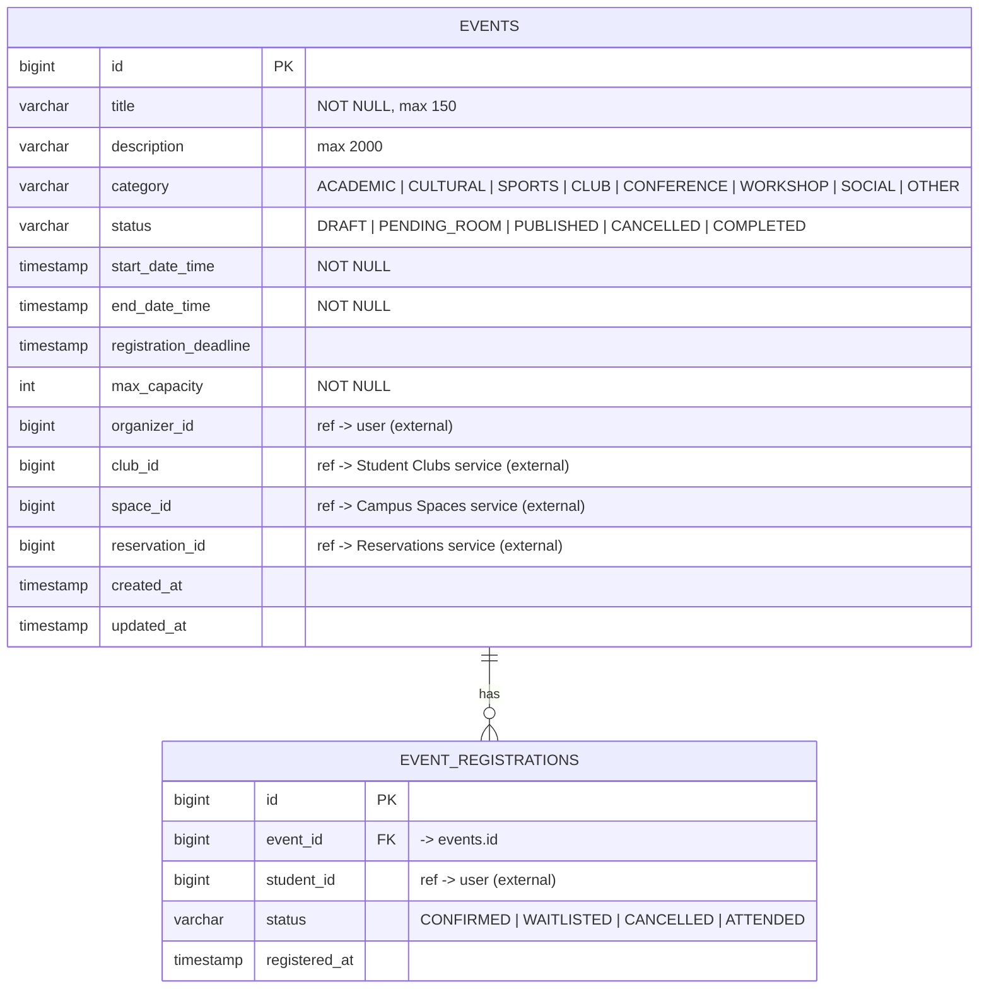
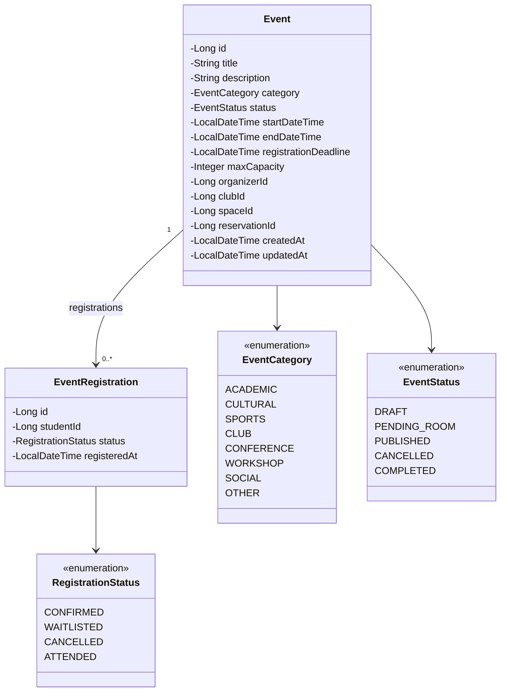

# MS4 — Event Service: Entity Relationship Diagram

Database: **`events_db`** (PostgreSQL, owned only by the Event service)

**Constraint:** `UNIQUE (event_id, student_id)`, so a student cannot register twice for the same event.

**Relationship:** one `Event` has 0..* `EventRegistration`s. Deleting an event deletes its registrations (cascade).

**External references** (`organizer_id`, `club_id`, `space_id`, `reservation_id`, `student_id`) are plain IDs.
They are **not** foreign keys, because those records live in other microservices' databases.

## UML class diagram

