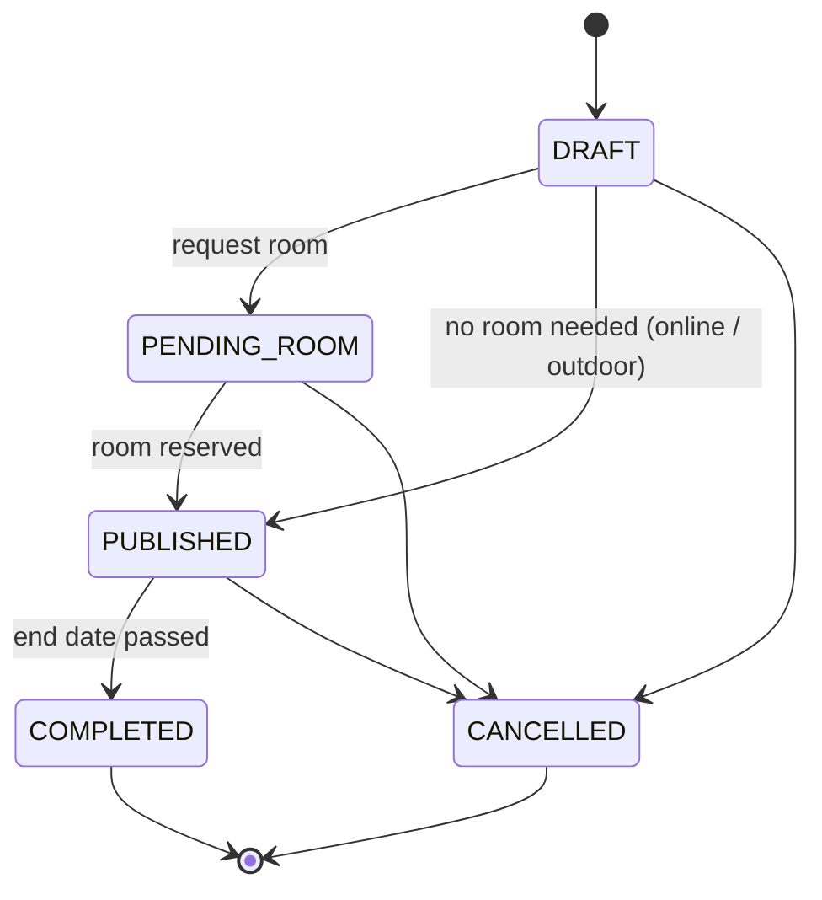
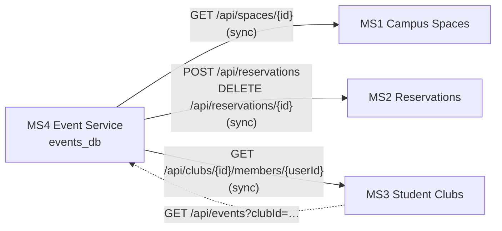

# MS4 — Event Service

**Owner:** isra  **Folder:** `Backend/event-service`  **Tech:** Spring Boot 4 · Java 21 · PostgreSQL  **Port:** 8084  **Database:** `events_db`

The Event service manages campus events: conferences, workshops, club activities, sports and cultural events.
It handles the event lifecycle and student registrations, and it works with the other services to get a room for each event.

---

## 1. Actors

| Actor | What they do in this service |
|---|---|
| **Student** | Browses events, registers or cancels a registration, sees their own registrations |
| **Club Manager** | Creates and manages events for their club |
| **Event Organizer** (staff or teacher) | Creates, updates, publishes and cancels academic or official events |
| **Administrator** | Manages all events, can cancel any event, sees statistics |
| **Other microservices** (system actors) | Campus Spaces, Reservations, Student Clubs (see section 7) |

## 2. Main features

1. Create, update and delete an event (draft)
2. Publish an event (it becomes visible to students)
3. Cancel an event (registered students are notified)
4. List and search events by category, date, status or club
5. Register a student for an event
6. Cancel a registration
7. Waiting list when the event is full
8. Mark attendance (ATTENDED)
9. List the participants of an event and the events of a student

## 3. Business rules

| # | Rule |
|---|---|
| R1 | `endDateTime` must be after `startDateTime`, and an event cannot be created in the past |
| R2 | `registrationDeadline` must be before `startDateTime` |
| R3 | Registration is possible only if the event is **PUBLISHED** and the deadline has not passed |
| R4 | A student cannot register twice for the same event (enforced by a database `UNIQUE` constraint) |
| R5 | When CONFIRMED registrations reach `maxCapacity`, new registrations become **WAITLISTED** |
| R6 | When a confirmed student cancels, the first WAITLISTED student is promoted to CONFIRMED |
| R7 | `maxCapacity` cannot be larger than the room capacity (checked with Campus Spaces) |
| R8 | An event is PUBLISHED only once its room is reserved; otherwise it stays **PENDING_ROOM** |
| R9 | Only the organizer, the club manager of the club, or an admin can modify or cancel an event |
| R10 | A CANCELLED or COMPLETED event cannot be modified or receive registrations |

**Event lifecycle:**



## 4. Entities

See the full diagram in [Diagrams/event-service-er.md](Diagrams/event-service-er.md).

**Event:** id, title, description, category, status, startDateTime, endDateTime, registrationDeadline, maxCapacity,
organizerId, clubId, spaceId, reservationId, createdAt, updatedAt

**EventRegistration:** id, event (FK), studentId, status, registeredAt

**Enumerations:** `EventCategory`, `EventStatus`, `RegistrationStatus`

**Relationship:** Event 1 ── 0..* EventRegistration

## 5. Why PostgreSQL, and how the data stays independent

**Why PostgreSQL**
- **Relational data with integrity.** Events and registrations are strongly linked. Foreign keys and `UNIQUE (event_id, student_id)` enforce the rules at the database level.
- **ACID transactions.** Two students taking the last seat at the same time must not both be confirmed. Transactions with row locking guarantee the capacity rule (R5).
- **Date and time queries.** Searching for upcoming events, events within a date range, or overlapping time slots is easy and fast with SQL, indexes and PostgreSQL range types.
- **Mature and free.** It works natively with Spring Data JPA and Hibernate, and it is open source.

**Data independence (database per service)**
- The Event service has its **own database, `events_db`**. No other service reads or writes it directly.
- Data from other services is referenced **by ID only** (`spaceId`, `reservationId`, `clubId`, `organizerId`, `studentId`). There are no cross-database foreign keys.
- Other services get event data **only through the REST API**.
- Each service can therefore change its schema, be deployed or be restarted without breaking the others.

## 6. REST API (planned)

Base URL: `http://localhost:8084/api/events`

### Events

| Method | Endpoint | Description | Success | Errors |
|---|---|---|---|---|
| GET | `/api/events` | List events (filters: `category`, `status`, `clubId`, `from`, `to`) | 200 | 400 |
| GET | `/api/events/{id}` | Get one event | 200 | 404 |
| POST | `/api/events` | Create an event (DRAFT) | 201 | 400, 409 |
| PUT | `/api/events/{id}` | Update an event | 200 | 400, 403, 404, 409 |
| DELETE | `/api/events/{id}` | Delete a DRAFT event | 204 | 403, 404, 409 |
| PATCH | `/api/events/{id}/publish` | Request a room and publish | 200 | 404, 409, 503 |
| PATCH | `/api/events/{id}/cancel` | Cancel an event | 200 | 403, 404, 409 |
| GET | `/api/events/health` | Service health check (**implemented**) | 200 | |

### Registrations

| Method | Endpoint | Description | Success | Errors |
|---|---|---|---|---|
| POST | `/api/events/{id}/registrations` | Register a student `{ "studentId": 12 }` | 201 | 400, 404, 409 |
| GET | `/api/events/{id}/registrations` | List participants of an event | 200 | 404 |
| DELETE | `/api/events/{id}/registrations/{studentId}` | Cancel a registration | 204 | 404 |
| PATCH | `/api/events/{id}/registrations/{studentId}/attendance` | Mark as ATTENDED | 200 | 404, 409 |
| GET | `/api/events/students/{studentId}/registrations` | Events of a student | 200 | |

### Example: create an event

```http
POST /api/events
Content-Type: application/json

{
  "title": "Spring Boot Workshop",
  "description": "Intro to microservices",
  "category": "WORKSHOP",
  "startDateTime": "2026-12-05T14:00:00",
  "endDateTime": "2026-12-05T17:00:00",
  "registrationDeadline": "2026-12-04T23:59:00",
  "maxCapacity": 40,
  "organizerId": 3,
  "clubId": 7,
  "spaceId": 15
}
```
Response **201 Created**, with the created event (`"status": "DRAFT"`) and a `Location: /api/events/1` header.

## 7. HTTP responses

| Code | Meaning | When |
|---|---|---|
| **200 OK** | Success | GET, PUT, PATCH succeeded |
| **201 Created** | Resource created | Event created, student registered |
| **204 No Content** | Deleted | Event or registration deleted |
| **400 Bad Request** | Invalid data | Missing title, end date before start date, negative capacity (R1, R2) |
| **403 Forbidden** | Not allowed | User is not the organizer, club manager or admin (R9) |
| **404 Not Found** | Does not exist | Unknown event ID or registration |
| **409 Conflict** | Violates a business rule | Already registered (R4), event not published or deadline passed (R3), event cancelled (R10), capacity greater than room capacity (R7) |
| **503 Service Unavailable** | Dependency down | Reservations or Campus Spaces unreachable during publish |

Error body format:
```json
{ "timestamp": "2026-11-11T22:30:00", "status": 409, "error": "Conflict",
  "message": "Student 12 is already registered for event 5", "path": "/api/events/5/registrations" }
```

## 8. Communication with other microservices



| Service | Direction | Data exchanged | Why |
|---|---|---|---|
| **MS1 Campus Spaces** | Event → Spaces | Sends `spaceId`, receives room name, capacity and availability | Check that the room exists and that `maxCapacity` ≤ room capacity (R7) |
| **MS2 Reservations** | Event → Reservations | Sends `spaceId`, start, end and `eventId`, receives `reservationId` and status | Book the room when publishing; release it when the event is cancelled (R8) |
| **MS3 Student Clubs** | Event → Clubs | Sends `clubId` and `userId`, receives whether the user is a manager of the club | Check that the user can create or modify club events (R9) |
| **MS3 Student Clubs** | Clubs → Event | Sends `clubId`, receives the club's events | Show a club's events on its page |

### Synchronous or asynchronous
- **Synchronous REST (HTTP)** for all calls in Validation 1, because the Event service needs the answer immediately (is the room free? is the user a manager?). The client will be Spring `RestClient` or OpenFeign, in the `client/` package.
- **Asynchronous (planned later, optional):** when an event is cancelled, publish an `EventCancelled` message (RabbitMQ or Kafka) so other services, such as notifications and reservations, can react without blocking the user.

### Failure handling

| Failure | Behaviour |
|---|---|
| **Reservations service down** during publish | The event is **not lost**: it stays `PENDING_ROOM`, the API returns **503** with a clear message, and the organizer (or a scheduled retry) publishes again later |
| **Campus Spaces down** | The room capacity check is skipped with a warning and the event stays `DRAFT` / `PENDING_ROOM` until the room is confirmed |
| **Student Clubs down** | Club-event creation is refused (**503**). Admins and organizers can still create non-club events |
| **Slow responses** | Timeouts (for example 3 s) on every HTTP client, so the Event service never hangs |
| **Repeated failures** | Circuit breaker (Resilience4j) with a fallback, so a failing service is not called again and again |
| **Room reserved but event save failed** | Compensation: call `DELETE /api/reservations/{id}` to release the room |

## 9. How to run

1. Create the database: run `Backend/event-service/database/init.sql` in pgAdmin (`CREATE DATABASE events_db;`)
2. Open `Backend/event-service` in IntelliJ
3. Run configuration → Environment variables: `DB_PASSWORD=<your postgres password>`
4. Run `EventServiceApplication`, then open http://localhost:8084/api/events/health

```json
{ "service": "event-service", "microservice": "MS4 - Events", "status": "UP" }
```

The `events` and `event_registrations` tables are created automatically on first start.
